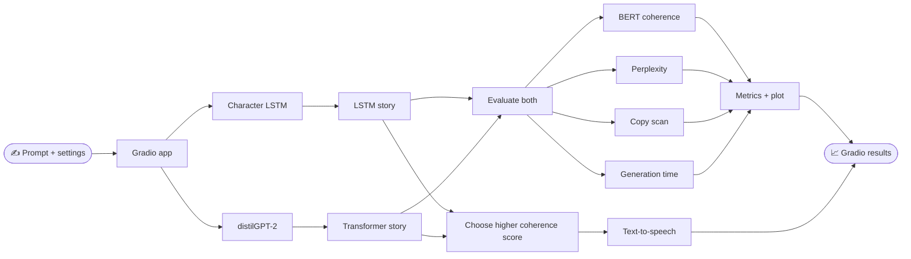

<div align="center">

# 🧸 LSTM vs Transformer
### Story Coherence Lab

**Can a Transformer keep a simple story on track better than an LSTM?**

Compare character-by-character and token-based generation on children's story prompts, then inspect their coherence, perplexity, and copying metrics.


</div>

---

## ✨ Explore the comparison

Enter a story opening and generate two continuations with the same sampling settings. The app scores both outputs and presents the results side by side.

| 🧠 Character LSTM | ⚡ distilGPT-2 |
|:--|--:|
| Two-layer model built with TensorFlow/Keras | Transformer model served with Hugging Face and PyTorch |
| Predicts one character at a time | Generates token sequences |

### 📊 What gets measured

- **Story coherence** — BERT Next Sentence Prediction scores across sentence distances
- **Language-model fit** — character-normalized perplexity
- **Memorization** — copied 8-gram percentage and longest copied span
- **Speed** — generation latency
- **Listening** — text-to-speech for the higher-scoring continuation

Sampling is shared between models: temperature, top-k, top-p, output length, and seed.

## 🗺️ How it works



## 🚀 Run it locally

### 1. Install dependencies

Python 3.12 is used by the included Docker image.

```bash
python -m venv .venv
```

Activate the environment and install packages:

```bash
# Windows PowerShell
.venv\Scripts\Activate.ps1

# macOS / Linux
source .venv/bin/activate

pip install -r requirements.txt
```

### 2. Add the LSTM checkpoint

Place these trained model files in `models/char_lstm/`:

```text
models/char_lstm/
├── vocab.json
└── char_lstm.weights.h5
```

> **Model files required:** The trained LSTM checkpoint and training script are not included in this repository. The app needs the checkpoint to start. BERT and distilGPT-2 model files are downloaded from Hugging Face if they are not already cached.

### 3. Launch the app

```bash
python app.py
```

Open **http://localhost:7860**. Set the `PORT` environment variable when running in a hosted environment.

## 🐳 Run with Docker

The Docker image pre-downloads the base distilGPT-2 and BERT checkpoints. Add the LSTM files above before building.

```bash
docker build -t story-coherence .
docker run --rm -p 8080:8080 story-coherence
```

Open **http://localhost:8080**.

## 🧰 Project map

```text
app.py                  Gradio interface and comparison flow
core/                   Models, scoring, guardrails, and speech
data/                    TinyStories corpus
report/                  Project report and report builder
Dockerfile               Container setup
requirements.txt         Pinned Python dependencies
```

📄 **Project report:** [`report/16_Atharv_P16.pdf`](report/16_Atharv_P16.pdf)

## ⚙️ Default sampling

| Temperature | Top-k | Top-p | New characters | Seed |
|:--:|:--:|:--:|:--:|:--:|
| 0.7 | 40 | 0.90 | 450 | 42 |

## 👨‍💻 Project

**Atharv Gawali · Roll No. 16 · Problem P16**  
Generative AI mini-project exploring story continuity in children's stories.
