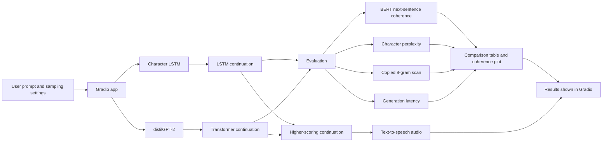

# LSTM vs Transformer Story Coherence Test

A small Gradio app that compares story continuations from a character-level LSTM and distilGPT-2. The project uses TinyStories-style children's story prompts to make character and plot continuity easy to inspect.

## What it compares

- **char-LSTM:** a two-layer character language model built with TensorFlow/Keras.
- **distilGPT-2:** a Hugging Face causal language model (PyTorch). If a fine-tuned checkpoint is present, the app uses it; otherwise it loads the base `distilgpt2` model.
- **Coherence:** BERT Next Sentence Prediction scores sentence pairs at different distances.
- **Other measures:** character-normalized perplexity, generation time, and a scan for copied 8-grams from the local corpus.
- **Audio:** reads the higher-scoring continuation with Google Text-to-Speech.

Both generators use the same prompt and sampling controls (temperature, top-k, top-p, output length, and seed). The app displays their continuations, metrics, and a coherence-by-distance plot.

## Application flow



## Repository contents

```text
app.py                  Gradio application
core/                   Model loading, generation, scoring, and guardrails
data/tinystories.txt    Local story corpus
report/                 Project report and report builder
Dockerfile              Container image definition
requirements.txt        Python dependencies
```

The project report is available at [`report/16_Atharv_P16.pdf`](report/16_Atharv_P16.pdf).

## Requirements

- Python 3.12 (the Docker image uses Python 3.12)
- Dependencies listed in `requirements.txt`
- Model artifacts for the character LSTM under `models/char_lstm/` (`vocab.json` and `char_lstm.weights.h5`)
- A trained LSTM checkpoint is required at startup. The app also loads `bert-base-uncased` for coherence scoring. The GPT-2 and BERT checkpoints are downloaded from Hugging Face unless already cached or baked into the Docker image.

The repository does not include the trained LSTM model artifacts or a training script, so obtain or create those artifacts before launching the app.

## Run locally

```bash
python -m venv .venv
```

Activate the virtual environment, then install the dependencies:

```bash
# Windows PowerShell
.venv\Scripts\Activate.ps1

# macOS / Linux
source .venv/bin/activate

pip install -r requirements.txt
python app.py
```

Open <http://localhost:7860>. The app accepts the `PORT` environment variable when running in a hosted environment.

## Docker

Build and run the container from the repository root:

```bash
docker build -t story-coherence .
docker run --rm -p 8080:8080 story-coherence
```

The Docker build pre-downloads the base distilGPT-2 and BERT checkpoints. Provide the LSTM artifacts in `models/char_lstm/` before building the image.

## Notes

- Default sampling settings are temperature `0.7`, top-k `40`, top-p `0.90`, 450 generated characters, and seed `42`.
- Generated model and evaluation outputs are not included in this repository.
- The report and app describe additional project experiments; the interactive app focuses on side-by-side story generation and its displayed metrics.

## Project

**Atharv Gawali · Roll No. 16 · Problem P16**  
Generative AI mini-project: LSTM vs Transformer coherence on children's stories.
